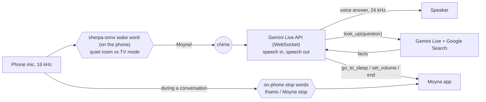

# Moyna (ময়না): a Bengali voice assistant on an old Android phone

**Turn a spare budget Android phone into an always-on, hands-free voice assistant for a Bengali-speaking parent or grandparent.**
Say *"Moyna"*, hear a chime, ask anything in Bengali (or English), and Moyna answers out loud in simple, warm, spoken Bangladeshi Bengali, powered by Google's Gemini Live API.

<p align="center">
  
  &nbsp;
  
  &nbsp;
  
</p>
<p align="center"><sub>Waiting · Listening (red stop button) · Sleeping after "stop". The whole interface is big Bengali text: no English, nothing to read in small print.</sub></p>

---

## Why I built this

My mom speaks Bangladeshi Bengali, a little English, and can't read much English. Phone assistants either don't understand her, answer in stiff textbook Bengali, or need her to unlock a phone and find an app. I had an old budget phone in a drawer, so I wanted something that **just sits in the living room, plugged in, and answers when she calls it by name**, the way a person would.

*Moyna* (ময়না) is the Bengali name for the hill myna, the talking bird. It also turned out to be a great wake word: short, distinctive, and easy for her to say.

Getting it right took a lot of real-world testing. The TV kept waking it up. It once got stuck chatting with a Bengali drama on the TV. It stopped itself by hearing its own voice. The phone only runs 32-bit apps. Every feature below exists because something like that happened in our living room.

## What it does

- 🗣️ **Natural Bengali conversation.** Real-time speech in, speech out (Gemini Live native audio). It answers in simple, respectful spoken Bangladeshi Bengali, or in English if spoken to in English. Short answers, a warm tone, and a 10-second window for follow-up questions.
- 🐦 **Wake word "Moyna", fully on the phone.** Offline keyword spotting with [sherpa-onnx](https://github.com/k2-fsa/sherpa-onnx). **Nothing leaves the phone until after the chime.** No account, no trial, no wake-word license.
- 📺 **TV mode.** When the room has been noisy for a while, Moyna switches to a stricter wake word. In testing this cut false wake-ups on TV-style speech from about 53 per hour to zero, without missing more real calls.
- ✋ **Stop, by voice or button.** A big red stop button, or say *"thamo"* / *"stop"*; while Moyna is talking, say *"Moyna stop"*. She stops instantly and **sleeps for 2 minutes**, so the TV can't wake her straight back up. Tap to wake her early.
- 🔇 **Echo cancellation.** The phone's echo canceller makes Moyna's own voice about 20× quieter in the mic during conversations, so she can hear you over herself.
- 🌦️ **Live information.** Weather, news, cricket scores, prices and prayer times are looked up with Google Search, then told back simply.
- 🧭 **Spoken commands.** *"Be quiet for an hour"*, *"louder / quieter"*, *"thank you, that's all"*, *"what time is it, what day is it?"* (it knows the real time here and in Bangladesh).
- 🩺 **Health-safe answers.** General information only, never doses or diagnoses, always "ask your doctor or *(someone you choose)*", and an urgent-symptoms rule to call the emergency number.
- 🔌 **Appliance-grade reliability.** Runs as a foreground service, starts by itself after a reboot, survives Wi-Fi drops, and plays a pre-recorded Bengali *"the internet isn't working"* message when offline. It's exempt from battery optimization.
- 📊 **Talk-time bar.** A thin bar along the bottom shows how much Moyna was used today (it resets at midnight).

## How it works



- **One conversation = one short Live session.** Her voice streams as 16 kHz PCM. Gemini's own voice-activity detection decides when she's finished, tuned to be patient with pauses. Answers stream back as 24 kHz audio.
- **While Moyna talks, the mic isn't sent to Gemini**, because Gemini would hear and transcribe its own echo. Interrupting works with the stop button, the "Moyna stop" phrase, or a loud voice close to the phone.
- **Look-ups use a second model.** On the free tier, Google Search only works with the older Live model, so the main model calls a `look_up` tool and the app asks the search-capable model in the background.

## What you need

- **An Android phone, Android 11 or newer.** Developed on a Snapdragon 430 budget phone that runs **32-bit only** (armeabi-v7a), and that's the ABI the app ships. Note the sherpa-onnx int8/"mobile" models hang on 32-bit ARM, so full-precision ones are used.
- **A Google Gemini API key** from [Google AI Studio](https://aistudio.google.com). The free tier works.
- **A Windows, macOS or Linux PC** with a USB cable. You build from the command line; no Android Studio is required.
- **Wi-Fi**, and a place to leave the phone plugged in.

## Setup

1. **Install a JDK 17, the Android SDK command-line tools** (platform 35, build-tools 35) **and `adb`.** Point `JAVA_HOME` and `ANDROID_HOME` at them.
2. **Clone the repository:**
   ```bash
   git clone https://github.com/Intiseier/moyna-bengali-voice-assistant.git
   cd moyna-bengali-voice-assistant
   ```
3. **Create `local.properties`** (private, git-ignored):
   ```properties
   sdk.dir=/path/to/Android/sdk
   GEMINI_API_KEY=your-key-here
   ```
4. **Copy `personal.properties.example` to `personal.properties`** and set who Moyna should suggest contacting (e.g. `her son`, `her daughter Rina`) and your emergency number.
5. **Prepare the phone:** enable USB debugging, disable the lock screen, and set media volume to max.
6. **Build and install:**
   ```bash
   ./gradlew assembleDebug        # Windows: gradlew.bat assembleDebug
   adb install -r build/outputs/apk/debug/app-debug.apk
   ```
   The APK path may differ: this build puts outputs in `%LOCALAPPDATA%/moyna-build` on Windows to keep cloud-synced folders clean. See the root `build.gradle.kts`.
7. **Give Moyna its always-on permissions** (once per phone):
   ```bash
   adb shell pm grant app.moyna android.permission.RECORD_AUDIO
   adb shell dumpsys deviceidle whitelist +app.moyna
   adb shell appops set app.moyna RUN_ANY_IN_BACKGROUND allow
   adb shell appops set app.moyna SYSTEM_ALERT_WINDOW allow
   adb shell am start -n app.moyna/.MainActivity
   ```
   `SYSTEM_ALERT_WINDOW` lets Moyna turn the screen on and come to the front when called.

> ⚠️ The API key is compiled into the APK. That's fine for a phone that stays in your home, but don't publish the APK.

## Make it yours

Everything easy to change is in [`MoynaConfig.kt`](app/src/main/java/app/moyna/MoynaConfig.kt): the model, the voice, the personality and system prompt, follow-up time, sleep time, TV-mode sensitivity, echo cancellation and the daily talk-time amount.

- **Wake word:** `app/src/main/assets/kws/wake.txt` (quiet room) and `wake-tv.txt` (TV mode). Each line is one way the name can sound, written as phonemes, with its own sensitivity. You can rename the assistant by writing new phonemes, no training needed.
- **Stop words:** `app/src/main/assets/kws/commands.txt`. Bengali words spoken alone are best written in Chinese-style pinyin (`t ā m ò` for *thamo*), because that's how this bilingual phoneme model hears them.
- **Spoken commands:** declared in `GeminiLiveClient.kt`, explained to the model in the system prompt, and handled in `MoynaEngine.onToolCall`. Add your own, such as "call my son" or reminders.

### Built-in test modes (from the PC over adb)

| Command | What it does |
|---|---|
| `adb shell am start -n app.moyna/.MainActivity --ei test_prompts 20` | **Beep test:** 20 beeps, 6 s apart; say "Moyna" after each. It counts catches and saves the recording for offline tuning. |
| `adb shell am start -n app.moyna/.MainActivity --ez echo_test true` | **Echo test:** measures how much of Moyna's own voice the mic hears, with and without echo cancellation. |
| `adb shell am start -n app.moyna/.MainActivity --ez tv_test true` | **TV test:** plays `echo-play.pcm` from the app's files folder like a TV, to check TV mode and false wakes. |
| `adb logcat -s Moyna` | Live log: wake-ups, what Gemini heard and said, commands, TV mode, errors. |

## Lessons from real-world testing

| Problem we hit | What fixed it |
|---|---|
| The English-spelled wake word "MOYNA" caught **1 of ~10** calls; the model heard *"why not", "my na", "mina"* | A phoneme-based model plus the spellings it actually hears (*moy-na, my-naa*): **15 of 16** caught |
| sherpa-onnx int8/"mobile" models **hung** on 32-bit ARM | Full-precision chunk-16 models: about 45 ms of work per 100 ms of audio |
| The TV woke Moyna about **53×/hour** | TV mode drops the one spelling (*my-nuh*) that caused it: **0** false wakes |
| Moyna **stopped herself**, hearing her own voice as "stop" | While she talks, a stop only counts after her name ("Moyna stop") |
| Gemini **transcribes its own echo**, even through the phone's echo canceller | The mic isn't streamed while Moyna talks; there's a separate on-phone stop listener |
| The end of the chime counted as "she's talking" | Wait for the speaker's latency before listening |
| Computer voices played through PC speakers made **useless** wake-word tests | Test with real voices (the beep test) |

## Costs, limits and privacy

- **The free tier works.** At the time of writing, Google's free tier lists **no daily request limit** for the Live models (only a per-minute token limit) and **1,500 Google Search look-ups per day** with the older 2.5 Live model. Search has **no** free allowance with Gemini 3 and newer models. Model names and limits change; check *Rate limits* in AI Studio.
- **On the free tier, Google may use what's said to improve its products.** Turning on billing for the key stops that (a few dollars a month for a few conversations a day).
- **The wake word runs entirely on the phone.** Audio goes to Google only after the chime, during a conversation.
- **This is not a medical device.** Moyna gives general information and always points to a doctor or family member.

## Credits

Built with [Gemini Live API](https://ai.google.dev), [sherpa-onnx](https://github.com/k2-fsa/sherpa-onnx), ONNX Runtime and OkHttp. See [THIRD_PARTY_NOTICES.md](THIRD_PARTY_NOTICES.md).

MIT License. Use it, change it, build it for your own family. If you do, I'd love to hear about it, and a ⭐ helps others find it.
