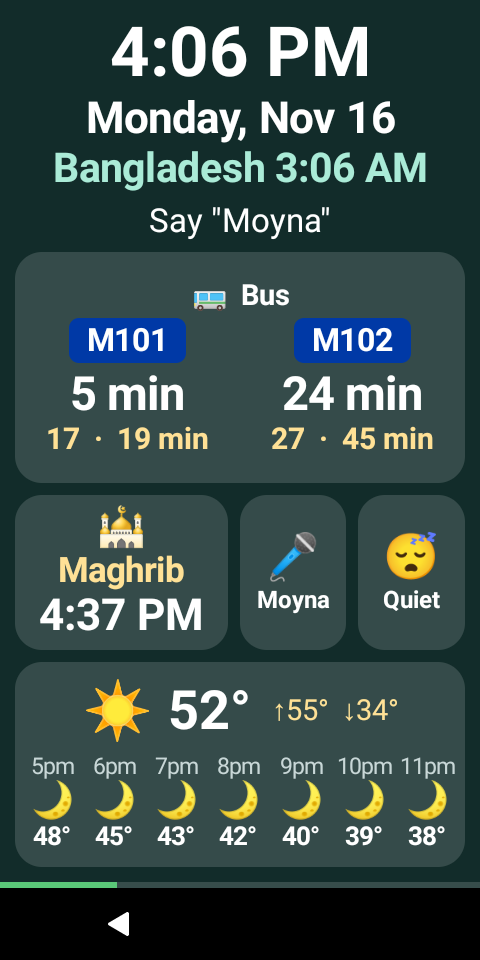
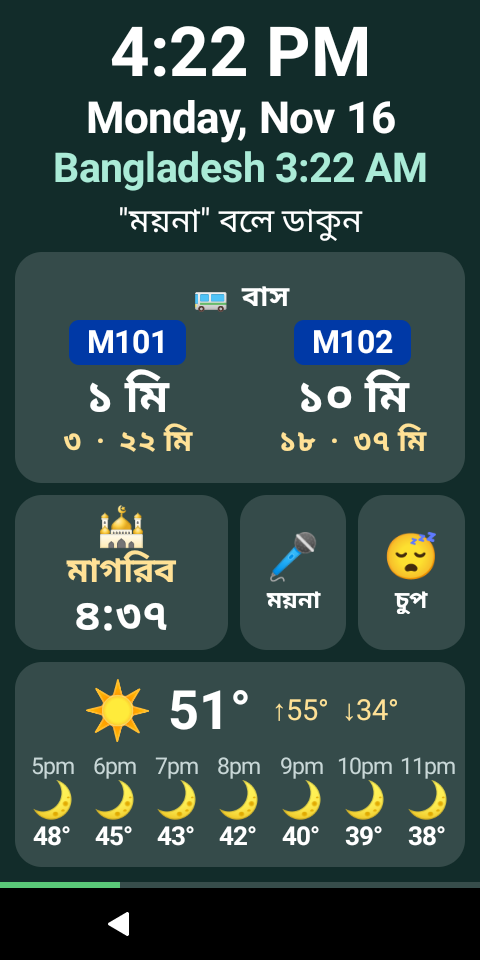
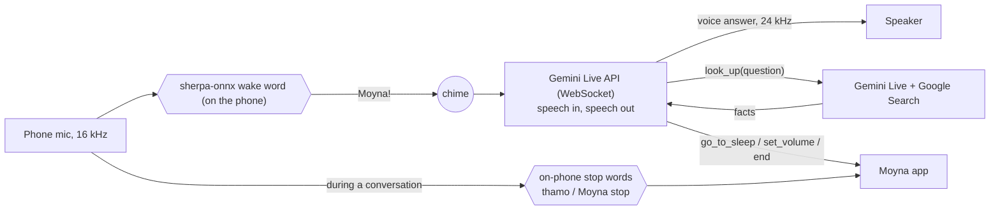

# Moyna (ময়না): a free Bengali voice assistant on an old Android phone

**Like Alexa, but in Bengali, and it costs nothing.** Turn the old Android phone sitting in your drawer into an always-on voice assistant for a Bengali-speaking parent, grandparent or relative.
They say *"Moyna"*, hear a chime, ask anything out loud in Bengali (or English), and Moyna answers out loud in simple, warm, spoken Bangladeshi Bengali.

**Powered by Google's free Gemini Live API.** No subscription, no new hardware, no app to open. All you need is an old Android phone, a charger, Wi-Fi and a free API key.

[](LICENSE)    

<p align="center">
  
  &nbsp;
  
  &nbsp;
  
  &nbsp;
  
  &nbsp;
  
</p>
<p align="center"><sub>The hub in English and in Bengali (one switch in the admin screen), listening, speaking, and the night look. (The bus lines shown are stand-ins from a public stop, not ours.)</sub></p>

**This page has two parts:**

1. **[Our build](#part-1-our-build)**: the wall hub I made for my mom, and what we learned making it.
2. **[Build your own](#part-2-build-your-own)**: the same app with your own key, buses, prayer calendar and settings. Everything personal lives in private files, so nothing of ours is baked in.

---

## Why I built this

My mom speaks Bangladeshi Bengali and a little English. Like a lot of older Bengali folks, she knows how to scroll YouTube and Facebook, and that's about it. She can't type a question into Google. She won't open an app and figure it out. For her, that's way too many steps.

But she *does* know how to talk to a voice assistant. She learned to say "Alexa, turn on the lights" and it just works. So I thought: what if there was one of those in **Bengali**, one she could ask anything?

Because that's the real gap. Older Bengali people mostly learn things by **talking to people**: about health, cooking, staying active, what's going on in the world. And people aren't always around to ask. So a whole world of information is basically locked behind typing, apps and English.

Moyna bridges that gap. It sits in one place in the living room, always plugged in, just like an Alexa. My mom says *"Moyna"*, asks her question in Bengali, and gets the answer back in Bengali, by voice. In a way she can finally use a search engine, in her own language, without learning English or touching a screen. She can just *yap* with it: about her knee pain, what to cook when it's raining, whether it'll rain today, or how the Bangladesh cricket team did.

I built it for my mom, but it's really for **any older Bengali person** who'd rather talk than tap.

*Moyna* (ময়না) is the Bengali name for the hill myna, the talking bird. It also turned out to be a great wake word: short, unique and easy to say.

Getting it right took a lot of real-world testing in our living room. The TV kept waking it up. It once got stuck chatting back and forth with a Bengali drama on the TV. It even stopped itself by hearing its own voice. Every feature below exists because something like that actually happened.

# Part 1: Our build

A budget phone on the living room wall, always plugged in, locked to this one app. This is what it does for my mom every day.

## What it does

- 🗣️ **Bengali conversation, kept short.** Real-time speech in, speech out (Gemini Live native audio). Moyna answers in one or two plain sentences of spoken Bangladeshi Bengali (or English if spoken to in English), with no small talk and no questions back. A conversation ends by itself after 3 answers.
- 🐦 **Wake word "Moyna", fully on the phone.** Offline keyword spotting with [sherpa-onnx](https://github.com/k2-fsa/sherpa-onnx). **Nothing leaves the phone until after the chime.** No account, no trial, no wake-word license. It works best within a few feet of the phone; from across a room, tap the 🎤 tile instead.
- 🏠 **A home hub on the wall.** A large clock with the date and Bangladesh time, big tiles with an emoji and a few words (English or Bengali, switched in the admin screen), live bus times for two lines, and a weather strip showing now and the next 7 hours. It dims when idle, and from 11 PM to 4 AM it goes black with a faint clock (a tap lights it up).
- 🚌 **Bus tile.** Live arrival times for your own stops (MTA Bus Time, New York), shown on the tile and spoken on a tap, about a second later.
- 🕌 **Prayer times and azan.** Times come from your own mosque calendar (typed into a small file), or are calculated when there is no file. The azan plays quietly at each prayer time; each prayer can be switched off. In Ramadan the tile counts down to the end of sehri and to iftar.
- 💡 **Light buttons.** TP-Link Kasa smart plugs get their own on/off tiles: yellow with "ON" when the light is on, grey with "OFF" when it's off. They talk to the plugs directly over the home Wi-Fi (no cloud, no Alexa needed, and Alexa and the plugs' own timers keep working). The tiles check the plugs every 30 seconds, so changes from Alexa or a timer show up too. They also work by voice: "Moyna", then *"light off koro"*, *"food on"* or *"lights off"* (Bengali, English or a mix).
- 🌦️ **Weather.** From Open-Meteo (free, no key). A tap says how it feels and whether rain or snow is coming in the next 12 hours.
- 🔎 **Live information.** News, cricket scores and prices are looked up with Google Search. Moyna says "একটু দেখে নিচ্ছি" at once and ticks softly until the answer is ready, usually 4 to 9 seconds.
- ✋ **Stop.** A big red stop button appears whenever Moyna is making sound. Saying *"thamo"* / *"stop"* also works when she is not talking over you. Stop ends the conversation; it does not put her to sleep.
- 😴 **Quiet.** The quiet tile, or *"be quiet for an hour"*, makes her ignore her name for a while. The screen says so, and a tap wakes her.
- 🧭 **Spoken commands.** *"Louder / quieter"*, *"thank you, that's all"*, *"what time is it?"* (she knows the real time here and in Bangladesh).
- 🩺 **Health-safe answers.** General information only, never doses or diagnoses, always "ask your doctor or *(someone you choose)*", and an urgent-symptoms rule to call the emergency number.
- 🔒 **Kiosk mode and a hidden admin screen.** Optional: lock the phone to Moyna so it can't be left by accident. Holding the clock for 15 seconds and entering a PIN opens an admin screen with today's activity, azan switches, the English/Bengali switch, a kid lock (the screen switches off and ignores taps; press volume-up 5 times to undo) and "exit kiosk".
- 📒 **Events log.** Every wake-up, question (text only, never audio), answer, tile tap and problem is written to a private log on the phone, with a script for a weekly summary.
- 🔌 **Appliance-grade reliability.** Runs as a foreground service, starts by itself after a reboot, survives Wi-Fi drops, and plays a pre-recorded Bengali *"the internet isn't working"* message when offline.

## How it works



- **One conversation = one short Live session.** Her voice streams as 16 kHz PCM. Gemini's own voice-activity detection decides when she's finished, tuned to be patient with pauses. Answers stream back as 24 kHz audio.
- **While Moyna talks, the mic isn't sent to Gemini**, because Gemini would hear and transcribe its own echo. On the test phone the speaker sits next to the microphone, so the phone cannot hear a voice over Moyna's own; interrupting is done with the red stop button, or by voice in a pause.
- **Tiles speak through a one-sentence Live session.** The app builds the Bengali sentence itself from fresh data and asks Gemini only to read it aloud, which starts about a second after the tap.
- **Look-ups use a second model.** On the free tier, Google Search only works with the older Live model, so the main model calls a `look_up` tool and the app asks the search-capable model in the background. That model also speaks its answer; the app stops as soon as the words are complete instead of waiting for the speech to finish, which cut look-ups from about 15 seconds to 4 to 9.
- **32-bit friendly.** The app ships only armeabi-v7a native code. The sherpa-onnx int8/"mobile" models hang on 32-bit ARM, so full-precision ones are used.

## Lessons from real-world testing

| Problem we hit | What fixed it |
|---|---|
| The English-spelled wake word "MOYNA" caught **1 of ~10** calls; the model heard *"why not", "my na", "mina"* | A phoneme-based model plus the spellings it actually hears (*moy-na, my-naa*): **15 of 16** caught |
| sherpa-onnx int8/"mobile" models **hung** on 32-bit ARM | Full-precision chunk-16 models: about 45 ms of work per 100 ms of audio |
| A "TV mode" with a stricter wake word made Moyna **stop answering**: ordinary talking switched it on, and a bug then ignored her name | Removed in version 2. One wake word list, always |
| A knock on the table **cut Moyna off** (the "loud voice interrupts" feature) | Removed. Stopping is the red button or a stop word |
| "Stop" put Moyna to sleep for 2 minutes, so she then **ignored her name** | Stop only ends the conversation; sleep only when asked |
| Look-ups took **15 seconds** | Stop waiting once the answer text is complete: 4 to 9 seconds |
| The light sensor made the screen go black whenever something covered it | Night look by the clock (11 PM to 4 AM) |
| The wake word **cannot hear from across the room** on this phone's microphone (0 of 20 at 7 feet, about 11 of 20 at 2 feet) | A big tap-to-talk tile on the hub |
| Moyna **stopped herself**, hearing her own voice as "stop" | While she talks, a stop only counts after her name ("Moyna stop") |
| Gemini **transcribes its own echo**, even through the phone's echo canceller | The mic isn't streamed while Moyna talks; there's a separate on-phone stop listener |
| The end of the chime counted as "she's talking" | Wait for the speaker's latency before listening |
| Computer voices played through PC speakers made **useless** wake-word tests | Test with real voices (the beep test) |

# Part 2: Build your own

The app is the same one that hangs on our wall. You bring your own key and settings.

## What you need

- **An old Android phone, Android 11 or newer.** A cheap one is perfect. Moyna was built on a Snapdragon 430 budget phone that only runs 32-bit apps.
- **A charger and Wi-Fi.** The phone stays plugged in, in one spot, like a smart speaker.
- **A free Google Gemini API key** from [Google AI Studio](https://aistudio.google.com) ("Get API key"). Treat it like a password.
- **A computer** (Windows, Mac or Linux) and a USB cable, just for setting it up.

## Set it up: two ways

### Option A: No coding. Let an AI do it (the "vibe-coded" way)

You don't need to understand any commands. An AI coding assistant that can run things on your computer will do the technical part, and you just follow along. Moyna itself was built exactly this way.

1. **Get the phone ready.**
   - Reset it to factory settings if you like (optional, but it gives a clean start). You can skip adding a Google account.
   - Turn on **Developer options**: go to *Settings → About phone* and tap **Build number** 7 times.
   - Go to *Settings → System → Developer options* and turn on **USB debugging**.
   - Plug the phone into your computer. When the phone asks *"Allow USB debugging?"*, tick **Always allow** and tap **Allow**.
2. **Get your free Gemini API key** at [aistudio.google.com](https://aistudio.google.com) → **Get API key** → **Create API key**. Keep it somewhere safe. **Don't paste it into a chat;** the AI will tell you which private file to put it in.
3. **Open an AI coding assistant that can run commands on your computer**, such as [Claude Code](https://claude.com/claude-code) or OpenAI Codex. A plain chat website can't install things on your computer or talk to the phone, so it won't work for this.
4. **Copy this whole message and send it to the AI:**

   ```text
   I want to set up "Moyna", a free Bengali voice assistant, on an old Android phone for
   my parent. The project is here: https://github.com/Intiseier/moyna-bengali-voice-assistant

   I'm not technical, so explain each step in plain, simple English and ask me before
   anything destructive. The phone is plugged into this computer with USB debugging on.

   Please:
   1. Download the project and read its README.md first.
   2. Install whatever is needed to build it (Java 17, the Android SDK command-line tools,
      adb), with no Android Studio. Check that `adb devices` shows my phone.
   3. Tell me exactly where to paste my Gemini API key (local.properties) so it never gets
      printed, logged, shared or uploaded anywhere. Never show the key back to me.
   4. Help me fill in personal.properties (who to suggest contacting for health questions,
      our emergency number, and if I want them: an admin PIN, my location for the weather,
      and my New York bus stops).
   5. Build the app and install it on my phone. Then run the permission commands from the
      README ("Option B", step 7), turn off the phone's screen lock, and set media volume to max.
   6. Help me test it: I'll say "Moyna", wait for the chime, and ask something in Bengali.
      If the wake word misses a lot, use the README's beep test to tune it.
   Stop at each step and tell me what to check on the phone.
   ```

5. **Answer its questions and follow along.** When it's done, unplug the phone from the computer, plug it into a wall charger in the living room, and say *"Moyna"*.

> 💡 Want changes later, like a different name, voice or personality, or a new command? Just ask the same AI: *"In the Moyna project, change …"*. Everything easy to change is in one settings file.

### Option B: Manual setup (for developers)

1. **Install a JDK 17, the Android SDK command-line tools** (platform 35, build-tools 35) **and `adb`.** Point `JAVA_HOME` and `ANDROID_HOME` at them.
2. **Clone the repository:**
   ```bash
   git clone https://github.com/Intiseier/moyna-bengali-voice-assistant.git
   cd moyna-bengali-voice-assistant
   ```
3. **Create `local.properties`** (private, git-ignored):
   ```properties
   sdk.dir=/path/to/Android/sdk
   GEMINI_API_KEY=your-key-here
   ```
4. **Copy `personal.properties.example` to `personal.properties`** and set who Moyna should suggest contacting (e.g. `her son`, `her daughter Rina`) and your emergency number. Optional: an admin PIN, your bus stops, and your home location for the weather. For the bus tile, also add a free `MTA_BUSTIME_KEY=...` to `local.properties`.
5. **Prepare the phone:** enable USB debugging, disable the lock screen, and set media volume to max.
6. **Build and install:**
   ```bash
   ./gradlew assembleDebug        # Windows: gradlew.bat assembleDebug
   adb install -r -t build/outputs/apk/debug/app-debug.apk    # -t: the app is marked testOnly (see Kiosk mode)
   ```
   The APK path may differ: this build puts outputs in `%LOCALAPPDATA%/moyna-build` on Windows to keep cloud-synced folders clean. See the root `build.gradle.kts`.
7. **Give Moyna its always-on permissions** (once per phone):
   ```bash
   adb shell pm grant app.moyna android.permission.RECORD_AUDIO
   adb shell dumpsys deviceidle whitelist +app.moyna
   adb shell appops set app.moyna RUN_ANY_IN_BACKGROUND allow
   adb shell appops set app.moyna SYSTEM_ALERT_WINDOW allow
   adb shell am start -n app.moyna/.MainActivity
   ```
   `SYSTEM_ALERT_WINDOW` lets Moyna turn the screen on and come to the front when called.

> ⚠️ The API key is compiled into the APK. That's fine for a phone that stays in your home, but don't publish the APK.

## What works right away, and what you add

With only a Gemini key, you get the clock, talking with Moyna, look-ups, the prayer tile (calculated times) and the quiet button. The rest switches on when you fill it in; a tile with nothing behind it is simply left off the screen.

| Piece | What it needs | Where it goes |
|---|---|---|
| Talking with Moyna | Free Gemini API key | `GEMINI_API_KEY` in `local.properties` |
| Health and emergency wording | Who to contact, emergency number | `personal.properties` |
| Weather strip | Your location (decimal degrees) | `HOME_LAT`, `HOME_LON` in `personal.properties` |
| Bus tile (New York) | Free [MTA Bus Time key](https://bustime.mta.info/wiki/Developers/Index) and your stop codes | `MTA_BUSTIME_KEY` in `local.properties`, `BUS_STOPS` in `personal.properties` |
| Your mosque's prayer times | One small CSV file per month (optional; otherwise calculated) | `private/prayer-times/` |
| Azan | A recording you have the right to use | `private/azan/azan.ogg` |
| Light buttons | TP-Link Kasa Wi-Fi plugs (tested: EP10, firmware 1.1.2) and your Kasa app login | `LIGHTS` in `personal.properties` (name, Bengali name and each plug's IP address); `KASA_EMAIL` and `KASA_PASSWORD` in `private/kasa-login.properties`. Only a one-way hash of the login is built into the app. Give the plugs fixed addresses in your router. |
| Admin screen | A 4-digit PIN | `ADMIN_PIN` in `personal.properties` |
| Kiosk mode | A phone with no accounts on it | See [Kiosk mode](#kiosk-mode-optional) |

`local.properties`, `personal.properties` and the `private/` folder are git-ignored, so your key, location and stops never end up on GitHub if you fork this.

## Make it yours

Everything easy to change is in [`MoynaConfig.kt`](app/src/main/java/app/moyna/MoynaConfig.kt): the model, the voice, the personality and system prompt, how many answers a conversation gets, the tiles, screen brightness, night hours and azan volume.

- **Tiles:** the `TILES` list in `MoynaConfig.kt`. Add, remove or reorder lines. Known ids: `bus`, `prayer`, `talk`, `quiet`, `weather` (drawn as a wide strip).
- **Wake word:** `app/src/main/assets/kws/wake.txt`. Each line is one way the name can sound, written as phonemes, with its own sensitivity. You can rename the assistant by writing new phonemes, no training needed.
- **Stop words:** `app/src/main/assets/kws/commands.txt`. Bengali words spoken alone are best written in Chinese-style pinyin (`t ā m ò` for *thamo*), because that's how this bilingual phoneme model hears them.
- **Spoken commands and tools:** declared in `GeminiLiveClient.kt`, explained to the model in the system prompt, and handled in `MoynaEngine.onToolCall`.
- **Bus stops, home location, admin PIN:** `personal.properties` (private). The bus code in `HubData.kt` uses New York's MTA Bus Time; another city needs its own transit API there.

### Prayer times: adding a month

Prayer times are read from CSV files in `private/prayer-times/` (a private, git-ignored folder; the build copies them into the app). One file per month, named like `2026-11.csv`, one line per day:

```text
date,fajr,sunrise,zuhr,asr_shafii,asr_hanafi,maghrib,isha,check
2026-11-01,5:11,6:26,11:40,2:28,3:10,4:52,6:09,
```

Times are typed as on a wall calendar, 12-hour with no AM/PM. The app uses the Hanafi Asr column. Add the new file and rebuild. For a month with no file, times are calculated (North America / ISNA method, Hanafi Asr) and marked with `*` on the tile; the admin screen reminds you a week before the calendar runs out. To use a different calculation, edit `PrayerCalc.kt`.

**Azan recording:** put `azan.ogg` (and, if you like, a separate `fajr.ogg`) in `private/azan/`. Use a recording you have the right to use; none is included in this repository.

### Kiosk mode (optional)

Kiosk mode makes Moyna the phone's home screen and only app, so it can't be left by accident. It needs a phone with **no accounts** on it.

```bash
adb install -r -t app-debug.apk                                # -t is required: the app is marked testOnly
adb shell dpm set-device-owner app.moyna/.AdminReceiver        # turn kiosk on (then open Moyna once)
adb shell dpm remove-active-admin app.moyna/.AdminReceiver     # turn kiosk off completely
```

The app is marked `android:testOnly="true"` on purpose: that is what allows `remove-active-admin` to work, so the phone never needs a factory reset to get out. You can also leave kiosk from the phone: hold the clock for 15 seconds, enter the `ADMIN_PIN` from `personal.properties`, and tap **Exit kiosk**.

The kid lock in the admin screen switches the screen off, which needs Moyna to be device owner. If you set up kiosk before the kid lock existed, run the two commands above once more (`remove-active-admin`, then `set-device-owner`) so Android sees the new permission; until then the kid lock is a black screen that turns off with the phone's own timeout.

### Events log

```bash
sh tools/pull-logs.sh             # copy the log from the phone to private/logs/events/
python tools/weekly-summary.py    # one-page summary of the last 7 days
```

The log is JSON Lines, one file per day, kept for 60 days in the app's private storage. It holds text only (what was heard and said, as transcribed), never audio.

### Built-in test modes (from the PC over adb)

| Command | What it does |
|---|---|
| `adb shell am start -n app.moyna/.MainActivity --ei test_prompts 20` | **Beep test:** 20 beeps, 6 s apart; say "Moyna" after each. It counts catches and saves the recording for offline tuning. |
| `adb shell am start -n app.moyna/.MainActivity --ez echo_test true` | **Echo test:** measures how much of Moyna's own voice the mic hears, with and without echo cancellation. |
| `adb shell am start -n app.moyna/.MainActivity --es look night` | Force the **night look** (`day` for the day look, `auto` to go back to the clock). |
| `adb shell am start -n app.moyna/.MainActivity --es lang bn` | Switch the words on the screen to **Bengali** (`en` for English). |
| `adb shell am start -n app.moyna/.MainActivity --es azan test` | Play the azan now. |
| `adb logcat -s Moyna` | Live log: wake-ups, what Gemini heard and said, commands, tiles, errors. |

## Costs, limits and privacy

- **The free tier works.** At the time of writing, Google's free tier lists **no daily request limit** for the Live models (only a per-minute token limit) and **1,500 Google Search look-ups per day** with the older 2.5 Live model. Search has **no** free allowance with Gemini 3 and newer models. Model names and limits change; check *Rate limits* in AI Studio.
- **On the free tier, Google may use what's said to improve its products.** Turning on billing for the key stops that (a few dollars a month for a few conversations a day).
- **The wake word runs entirely on the phone.** Audio goes to Google only after the chime, during a conversation.
- **This is not a medical device.** Moyna gives general information and always points to a doctor or family member.

## What's next (ideas)

- 📲 **A downloadable app**: install from a link, enter your key on the phone, done. No computer needed.
- 🎯 **A custom-trained wake word** that hears from across the room.
- ⏰ **Reminders**: *"remind me at 5 to take my medicine"*, spoken at the right time.
- 📞 **"Call my son"**: send a notification to a family member's phone when she asks.
- 🌍 **Other languages**: the same idea works for any language Gemini speaks; only the wake word and prompts change.

Ideas and pull requests are welcome.

## Credits

Built with [Gemini Live API](https://ai.google.dev), [sherpa-onnx](https://github.com/k2-fsa/sherpa-onnx), ONNX Runtime and OkHttp. See [THIRD_PARTY_NOTICES.md](THIRD_PARTY_NOTICES.md).

MIT License. Use it, change it, build it for your own family. If you do, I'd love to hear about it, and a ⭐ helps others find it.
